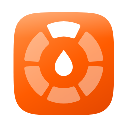
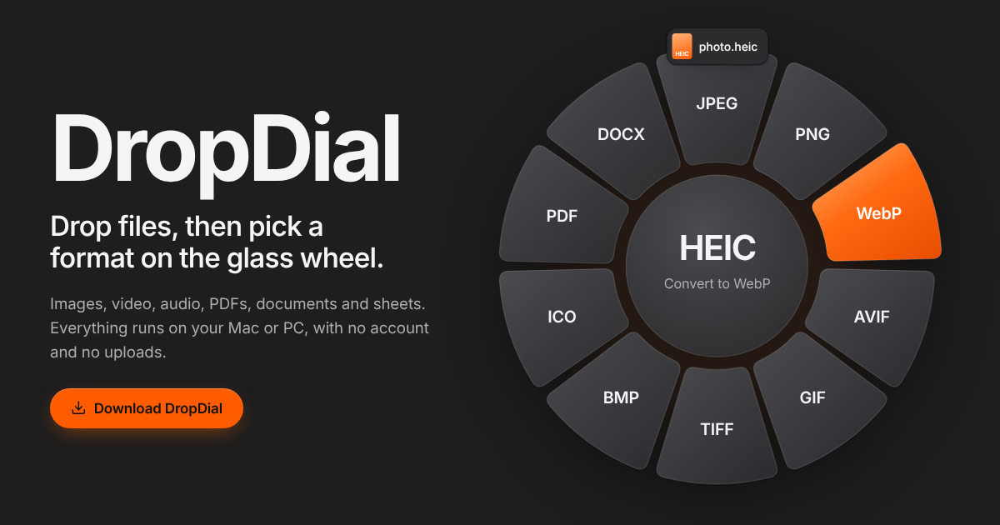
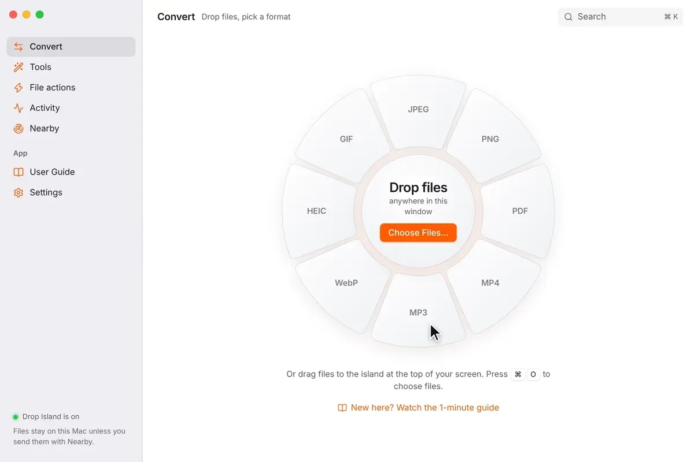
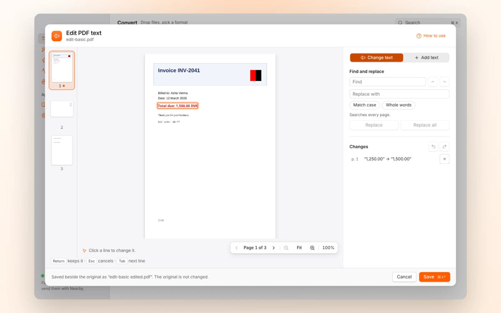
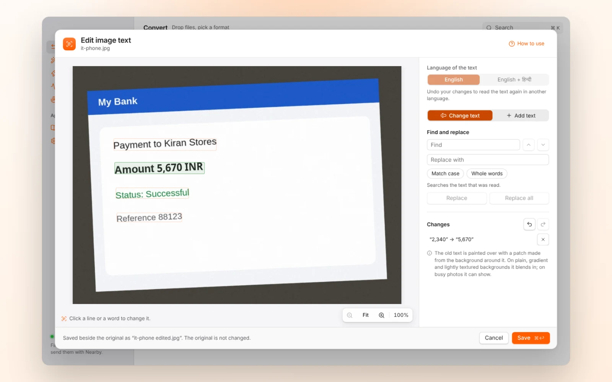
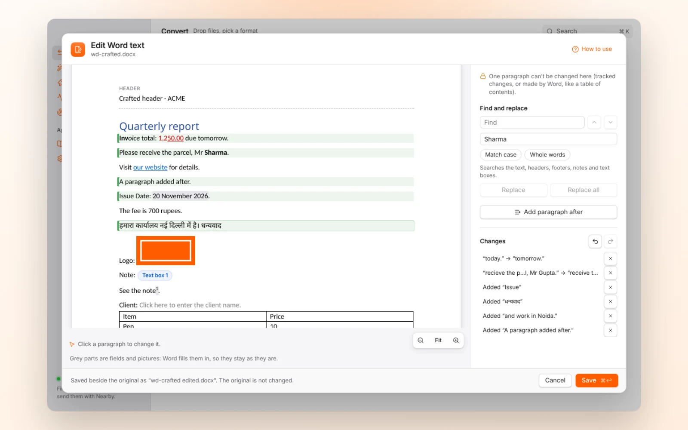
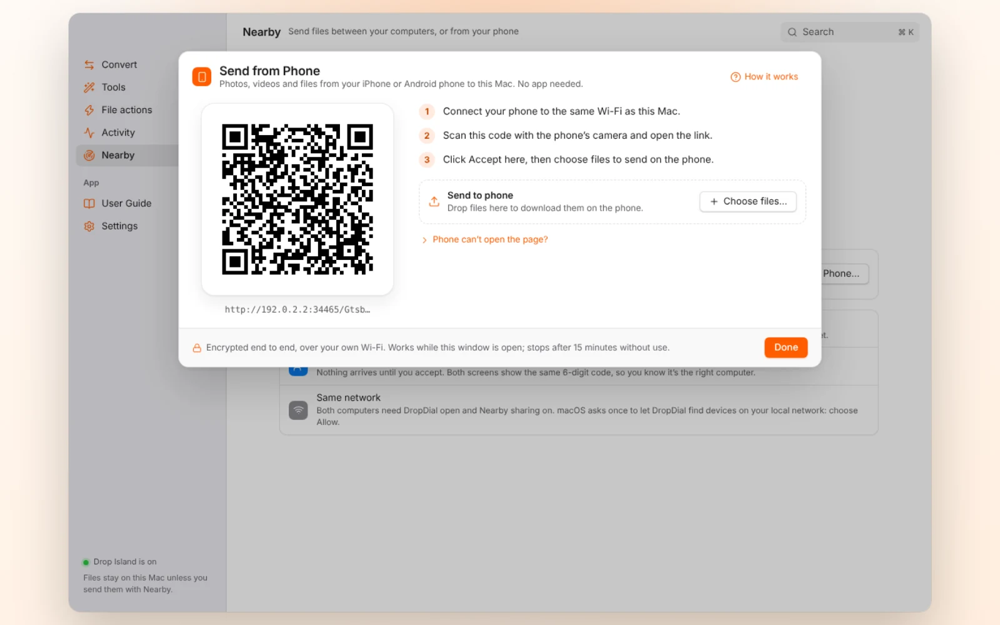
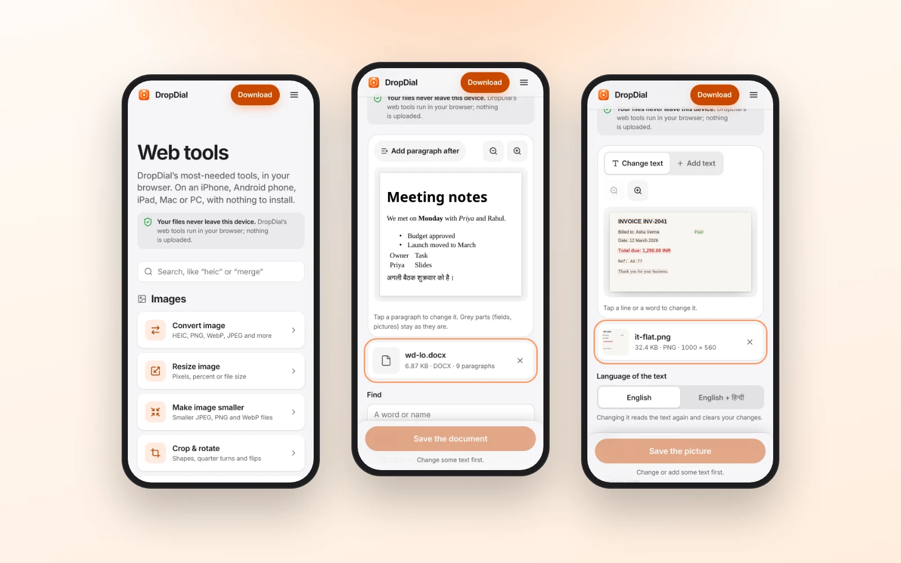
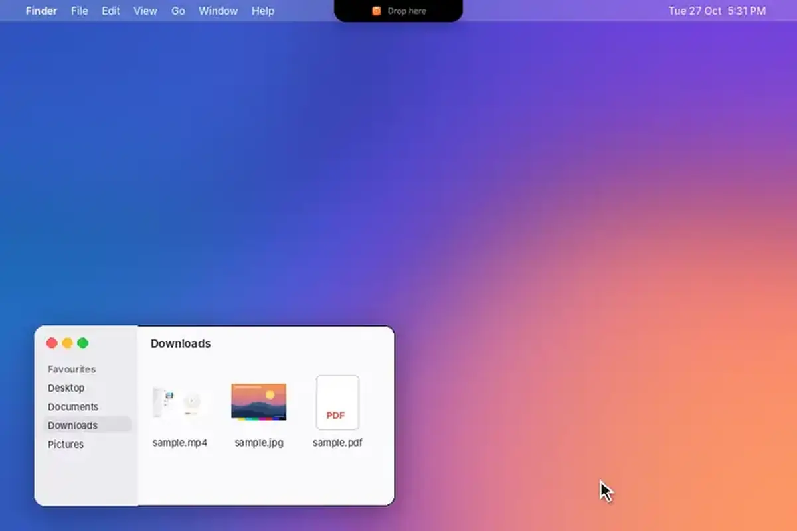

# DropDial

### Drop files. Point at a format. Click.

The file converter and toolkit for **Mac** and **Windows**. 
Images, video, audio, PDFs, Word documents and sheets, all on your own computer. 
No account. No uploads. No ads.

 

&nbsp;

&nbsp;

 

[Website](https://unknown8575.github.io/DropDial-Releases/) · [Web tools](https://unknown8575.github.io/DropDial-Releases/tools/) · [User guide](https://unknown8575.github.io/DropDial-Releases/guide/) · [All versions](https://github.com/unknown8575/DropDial-Releases/releases)

 

## Drop. Point. Click.

One wheel for every format. Drop files on the window, point at a format, and the middle of the wheel tells you what will happen, like *Convert to WebP*. Click, and each file gets its own new copy next to the original. Your originals never change, and one file that fails doesn't stop the rest.

  <picture>
    <source media="(prefers-color-scheme: dark)" srcset="assets/convert-dark.webp">
    
  </picture>

**229 ways to convert on a Mac, 221 on Windows.** JPEG, PNG, WebP, HEIC, AVIF, TIFF, GIF, BMP, ICO and SVG · MP4, MOV, MKV, WebM, AVI and WMV · MP3, M4A, WAV, FLAC, OGG, Opus, AIFF and WMA · PDF, DOCX, TXT and Markdown · CSV, XLSX and XLS.

 

## Change the words in anything

Fix a name, a date or an amount, and keep everything else exactly as it was. All three editors run on your computer, read **English and Hindi**, and save a new file next to the original.

### Edit PDF text

Click a line and type. Replace a word on every page, or add new text. The old words are **taken out of the PDF**, not hidden under a white box, so nobody can find or copy them afterwards.

  <picture>
    <source media="(prefers-color-scheme: dark)" srcset="assets/edit-pdf-dark.webp">
    
  </picture>

### Edit image text

Photos, screenshots and scanned PDFs. DropDial reads the text, you click a word and type the new one, and the old one is painted over to match the background. Scanned PDFs can be made searchable as well.

  <picture>
    <source media="(prefers-color-scheme: dark)" srcset="assets/edit-image-dark.webp">
    
  </picture>

### Edit Word text

Click any paragraph in a `.docx` (body, tables, headers, footers, footnotes or text boxes) and type over it. Find and replace catches every match, even where Word has split a word into pieces. Only the words you change are touched, so fonts, links and pictures stay exactly as they were.

  <picture>
    <source media="(prefers-color-scheme: dark)" srcset="assets/edit-word-dark.webp">
    
  </picture>

 

## 35 tools, one drop away

Each tool opens with a large preview, and DropDial only offers the tools that fit your files.

<table>
<tr><td><b>Images</b></td><td>Adjust photo · Background & frame · Crop & straighten · Hide details · Resize · Rotate & flip · Images to PDF · Collage · Read QR code · Edit image text</td></tr>
<tr><td><b>Video</b></td><td>Trim · Crop & reframe for Reels, Shorts, square or 16:9 · Change speed · Cut into parts · Combine videos · Save frames · Blur faces or plates · GIF & sticker</td></tr>
<tr><td><b>Audio</b></td><td>Trim with fades · Even out volume · Stereo & mono · Beep out parts · Audio to video · Reduce noise</td></tr>
<tr><td><b>PDF</b></td><td>Combine · Split · Arrange pages · Shrink · Page numbers · Watermark · Edit PDF text</td></tr>
<tr><td><b>Documents</b></td><td>Edit Word text</td></tr>
<tr><td><b>Money</b></td><td>Analyze a bank statement (PDF, CSV or Excel) to see where your money went</td></tr>
<tr><td><b>Any file</b></td><td>Make smaller · Info & privacy</td></tr>
</table>

 

## Send from your phone

Scan a QR code with your iPhone or Android phone and send photos, videos and files straight to your Mac or PC over your own Wi‑Fi, or send files the other way. No app is needed on the phone, and everything is **encrypted end to end**.

  <picture>
    <source media="(prefers-color-scheme: dark)" srcset="assets/send-from-phone-dark.webp">
    
  </picture>

**Nearby** works like AirDrop between your Mac and your PC. Files go straight across your own network and never through the internet. Both screens show the same code, so you know it's the right computer.

 

## Use it in your browser

No install, and nothing uploaded. **32 of DropDial's tools** run right in the browser on an iPhone, Android phone, iPad or any computer: convert HEIC photos, make pictures and videos smaller, combine PDFs, edit PDF, image and Word text, trim videos and songs, and more. The web tools run the same code as the app, and closing the page clears everything.

  <a href="https://unknown8575.github.io/DropDial-Releases/tools/">
    <picture>
      <source media="(prefers-color-scheme: dark)" srcset="assets/web-tools-dark.webp">
      
    </picture>
  </a>

<a href="https://unknown8575.github.io/DropDial-Releases/tools/"><b>Open the web tools →</b></a>

 

## Drop Island

A small pill at the top of your screen; on a MacBook it sits in the notch. Drag files onto it, and the wheel opens right there without opening the window. Hold <kbd>⌘</kbd>/<kbd>Ctrl</kbd> for tools and <kbd>⌥</kbd>/<kbd>Alt</kbd> for file actions.

  

 

## Private by design

- **Your files stay on your computer.** Converting, every tool and bank statements all work offline.
- **No account, no cloud, no ads, no tracking.**
- **Your originals are never changed.** Every result is a new file; only *Rename…* and *Move to…* touch existing files, and a rename can be undone.
- **Made for both systems.** Traffic lights and <kbd>⌘</kbd> on a Mac, window buttons and <kbd>Ctrl</kbd> on Windows, with the same wheel, tools and Nearby on both.

 

## Download

The [download page](https://unknown8575.github.io/DropDial-Releases/download/) picks the right file for you. Or take it from the [latest release](https://github.com/unknown8575/DropDial-Releases/releases/latest):

| Your computer | File | Needs |
|---|---|---|
| Mac with Apple silicon (M1 or later) | `DropDial-<version>-macOS-arm64.zip` | macOS 12 or later |
| Mac with Intel | `DropDial-<version>-macOS-x64.zip` | macOS 12 or later |
| Windows PC | `DropDial-<version>-Windows-Setup.zip` | Windows 10 or 11, 64-bit |

Not sure which Mac you have? Apple menu → About This Mac: Apple silicon shows a <b>Chip</b> (M1, M2…), Intel shows a <b>Processor</b>.

<b>Install on a Mac</b>

 

1. Open the downloaded `.zip`. DropDial appears next to it.
2. Move DropDial to your **Applications** folder and open it.
3. If macOS says it can't check the app, open **System Settings → Privacy & Security**, scroll down and click **Open Anyway**.

DropDial isn't notarized by Apple yet, so macOS asks once. After that it opens like any other app.

<b>Install on Windows</b>

 

1. Right-click the downloaded `.zip` and choose **Extract All…**
2. Run **DropDial Setup**. It installs in one click.
3. If SmartScreen says *"Windows protected your PC"*, click **More info**, then **Run anyway**.

The installer isn't code-signed yet, so Windows asks once.

<b>Updates</b>

 

DropDial looks for a new version once a day. When there is one, a bar at the top of the window offers **Update**, and the new version installs when you click **Restart to update** or quit DropDial. To look right away, click **Check now** in Settings → General; you can turn the daily check off there too. Every download is checked against its fingerprint before it's installed.

 

## Questions

<b>Is DropDial free?</b>

 
Yes, for personal and work use.

<b>Are my files uploaded anywhere?</b>

 
No. Converting, the tools and the text editors all work on your computer, and the web tools work inside your browser. Files only go to another device when you send them with Nearby or Send from Phone, and then they go straight across your own network.

<b>Can I change the text in a PDF, a photo or a Word file?</b>

 
Yes. <b>Edit PDF text</b> takes the old words out of the page. <b>Edit image text</b> reads photos, screenshots and scans in English and Hindi, then paints the old words over to match the background. On plain and gradient backgrounds it blends in; on busy photos the patch can show. <b>Edit Word text</b> changes only the words you type, so the rest of the document stays exactly as it was.

<b>Is there a phone app?</b>

 
Not yet. DropDial is a desktop app for Mac and Windows, but its <a href="https://unknown8575.github.io/DropDial-Releases/tools/">web tools</a> work in the browser on any phone or tablet. To get files from your phone to your computer, use Send from Phone; nothing needs to be installed on the phone.

<b>Will DropDial overwrite my files?</b>

 
No. Every conversion and tool saves a new file. Only the file actions <i>Rename…</i> and <i>Move to…</i> change existing files, and a rename can be undone in Activity.

 

**DropDial**

[Website](https://unknown8575.github.io/DropDial-Releases/) · [Download](https://unknown8575.github.io/DropDial-Releases/download/) · [Web tools](https://unknown8575.github.io/DropDial-Releases/tools/) · [Guide](https://unknown8575.github.io/DropDial-Releases/guide/) · [Terms & Privacy](https://unknown8575.github.io/DropDial-Releases/legal/)

This repository holds DropDial's installers and its website. © 2026 Yash Gupta. All rights reserved.

